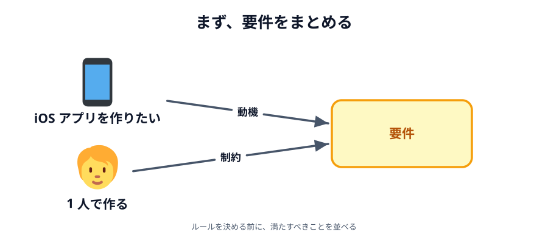
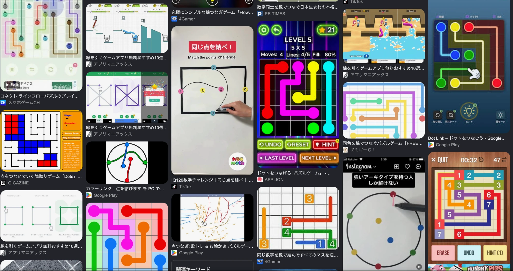
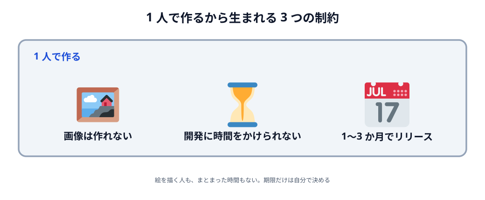
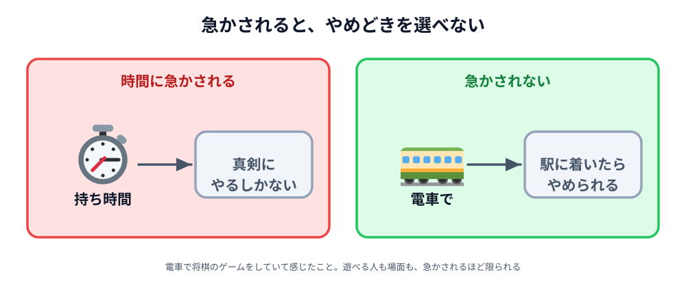
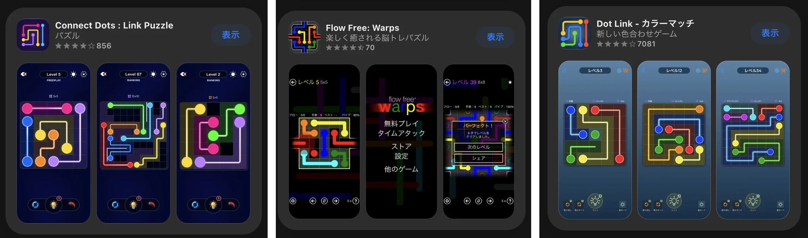
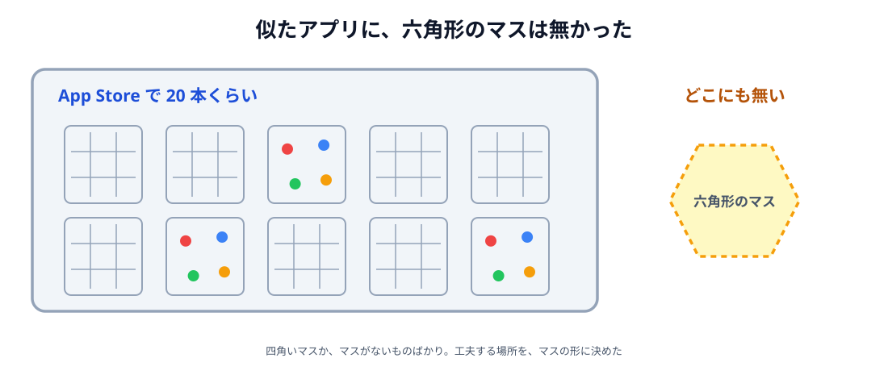
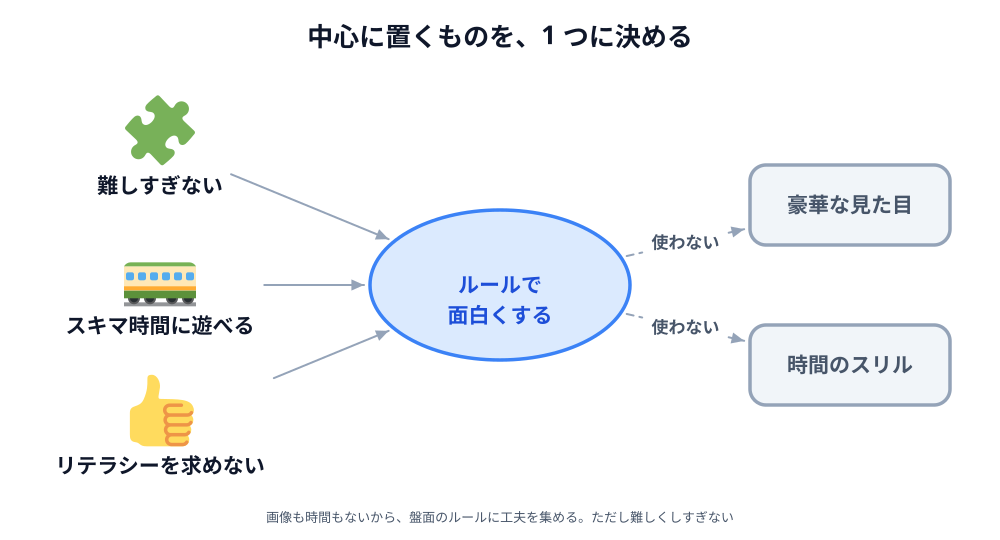

# 01 作りたいものと要件をまとめる

ここまでで、ブラウザ同士をつなぐアプリを 2 つ作りました。
この章では、コードを 1 行も書きません。かわりに、**自分でアプリを作るときに、どう進めるか**を追いかけます。

題材は、私が個人で作って App Store に出したパズルゲーム
[Connect Dots Puzzle](https://apps.apple.com/jp/app/id6816620739) です。
六角形のマスが並んだ盤面で、同じ色の点どうしを一筆書きの線でつなぎます。

設計は、いきなり画面やコードを考えることではありません。
まず**満たすべきことを並べて**、そこから作るものと作る順番を決めていきます。

この節はその一歩目、**要件をまとめる**ところです。

## 作ってみたかったもの

出発点は、**iOS アプリを 1 本作ってみたい**という気持ちでした。

最初に外したのは、**サーバーや認証が要るもの**です。
ログインやデータの保存をサーバーで持つと、作るのも動かし続けるのも、1 人には重すぎます。
そこで、**1 人で遊べて、端末の中だけで完結するゲーム**にしました。

もう 1 つ決めたのは、**新しいゲームを生み出さなくていい**ということです。
広告で、点と点を線でつなぐパズルをよく見かけていました。
目的はアプリを作って出すことなので、遊び方そのものは、**広告で見たことのあるゲーム**を借りることにしました。

_図: 点と点を線でつなぐパズルは、探すとたくさん見つかる。_

決まったのはここまでです。この段階では、**どんな盤面で、どんなルールにするか**はまだ決めていません。

## 1 人で作るから生まれる制約

次に、**1 人で作るから生まれる制約**を並べました。
技術的に難しいかどうかとは別の、自分の手持ちから来る条件です。

**リッチな画像は作れません。**
キャラクターや背景の絵を描く人はいないので、見た目は図形と色だけで作ることになります。

**開発に時間をかけられません。**
まとまった時間は取れないので、**少しずつでも進められる**作り方にする必要があります。

**1〜3 か月でリリースしたい。**
ずっと作り続けて出さないままにはしたくないので、期限を決めました。

_図: どれも技術の制約ではなく、1 人で作るから生まれた条件。_

## 作るものに求める要件

制約が出そろったので、**作るものに求めること**を 3 つにまとめました。

**1. 難しすぎるゲームにしない。**
パズルは、凝るほど解ける人が減っていきます。ほどほどに考えれば解ける難しさにとどめます。

**2. スキマ時間に遊べる。**
遊ぶ場面として思い浮かべたのは、**電車で移動しているあいだ**です。
これは、私自身が電車で将棋のゲームをしていて感じたことから来ています。
持ち時間に急かされると真剣にやるしかなく、そうなると遊べる人も場面も限られてしまいます。
降りる駅に着いたら、そのままやめられる。急かされない。そういうものにします。

**3. 高いリテラシーを求めない。**
ゲームに慣れていない人でも、画面を見れば遊び方が分かること。
説明を読まないと始められないものにはしません。

_図: 時間に急かされないことを、要件として先に書いておく。_

3 つとも「何ができるか」ではなく、**遊ぶ人にとってどういうものか**を書いています。
このあとルールを決めるとき、案を拾うか捨てるかは、この 3 つで判断します。

## 似たアプリを調べる

作るものの形を決める前に、**同じようなアプリがどれくらいあるか**を調べました。
App Store で検索して、20 本くらいを見ています。

_図: App Store で検索したときの例。どれも四角いマスの上で点をつないでいる。_

分かったのは、**ほとんどが方眼紙のような四角いマスか、マスがまったくない形**だということです。
マスのないものは、白い紙の上に点が置いてあって、そこに自由に線を引きます。
そして、**六角形のマスのものは 1 本もありませんでした**。
同じものを作っても、わざわざ選んでもらう理由がありません。
遊び方は借りるとしても、**どこかを工夫する**必要があります。

_図: 調べてみると、まだ誰も作っていない場所が見えてくる。_

工夫する場所として選んだのが、**マスの形**です。どこにもなかった**六角形（ハニカム）のマス**にしました。
となりのマスが 4 つから 6 つに増えるので、線の通り道が変わり、同じ考え方では解けなくなります。
しかも、見た目は図形のままなので、画像が作れないという制約にもぶつかりません。

## 制約と要件をまとめる

制約と要件が出そろいました。あとは、**今ある制約の中で要件を満たす方法**を考えます。

画像は作れず、開発に時間もかけられません。
だから、見た目の豪華さや、時間制限のようなスリルで面白くすることはできません。

**ルールで面白くする。**
ここが中心です。図形と色だけの画面でも、盤面のルールに工夫があれば十分に遊べます。

**ただし、難しくしすぎない。**
工夫を足すほど、ルールは複雑になります。
「難しすぎない」「高いリテラシーを求めない」とぶつからないところで止めます。

逆に、絵や演出がそろって初めて面白くなる作り方は選びません。
これが、このゲームの要件です。

_図: 制約の中で要件を満たすとは、何を捨てるかではなく、何を中心に置くかを決めること。_

要件はまとまりました。次の節では、ここからルールと作る順番を決めます。

:::faq

### 新しいゲームを考えなくてもいいのですか

いいと思います。今回の目的は**アプリを作って出すこと**で、新しい遊びを発明することではありませんでした。
遊び方は既にあるものを借りて、**似たアプリと比べてどこを変えるか**だけを考えれば、
作る意味は十分に出せます。工夫する場所は、市場を調べると見えてきます。

### サーバーを使わないゲームにしたのはなぜですか

サーバーや認証は、作るだけでなく、**動かし続ける**手間とお金がかかるからです。
ログインの仕組み、データベース、障害が起きたときの対応。どれも 1 人で持つには重すぎます。
端末の中だけで完結するなら、リリースしたあとに面倒を見るものがぐっと減ります。

### 制約と要件は、何が違うのですか

**制約は、こちらで変えられない前提**です。画像は作れない、開発に時間をかけられない、といった条件がこれです。
**要件は、その前提の中で満たしたいこと**です。難しすぎない、スキマ時間に遊べる、リテラシーを求めない。
順番が大事で、制約を先に並べておかないと、現実に合わない要件を決めてしまいます。

### 似たアプリを調べると、何が分かるのですか

**作る意味があるかどうか**です。同じものがたくさんあるなら、そのまま作っても選んでもらえません。
今回は「四角いマスか、マスがないものばかりで、六角形はない」と分かったことで、工夫する場所がマスの形に決まりました。
要件を書いておくと、調べたアプリを見たときに「これは自分の要件に合うか」も判断できます。

### 「スキマ時間に遊べる」は、機能ではないのに要件なのですか

要件になります。「何ができるか」だけでなく、
**できあがったものがどういう性質を持っているか**も要件に書けます。
速さ、分かりやすさ、中断しやすさ。現場で**非機能要件**と呼ばれているものがこれです。
今回は、この要件が時間制限という案を捨てる理由になりました（次の節）。

:::
