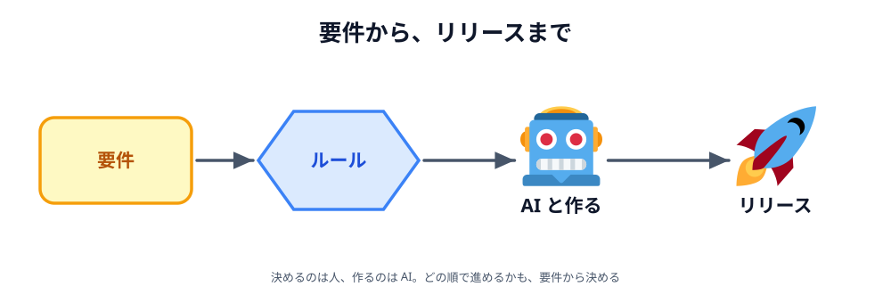
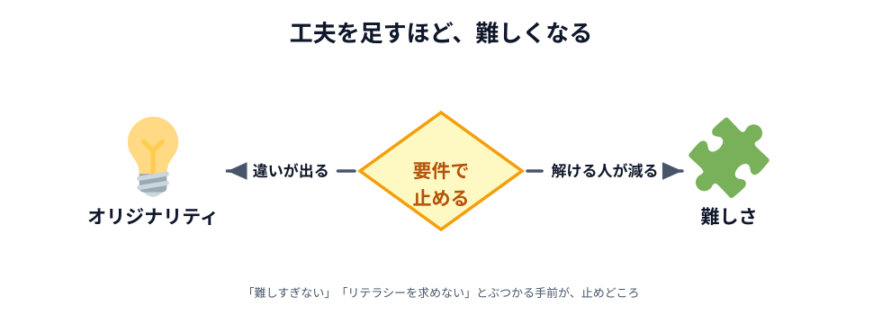
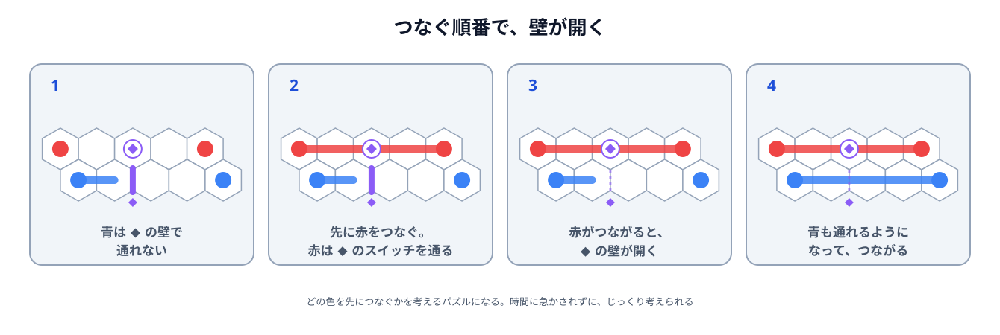
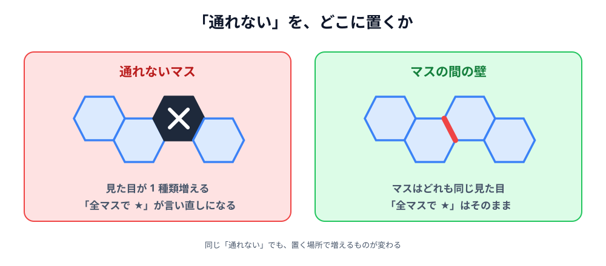
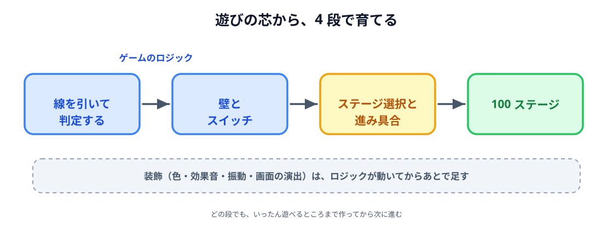
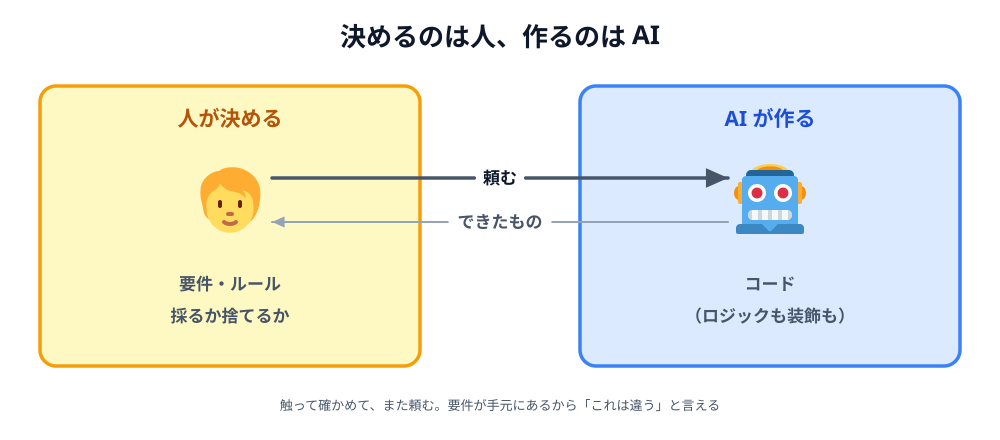
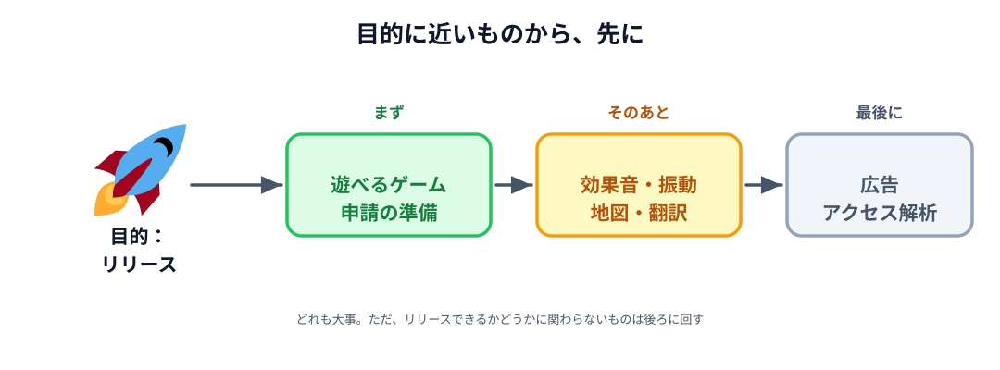

# 02 要件からルールを決め、AI と作る

要件はまとまりました。残っているのは、**どんなルールにするか**・**どの順で作るか**・**何で作るか**・**何をあとに回すか**です。

この節では、Connect Dots Puzzle がリリースされるまでを、その順番でたどります。

## ルールを足して、削る

マスを六角形にしたことで、似たアプリのどれとも違うものになりました。
ただ、それだけでは「形が違う」だけで、遊んだときの手ごたえはあまり変わりません。
そこで、**ゲーム性を足す案**を考えました。

ここで引っぱり合うのが、**オリジナリティ**と**難しさ**です。
工夫を足すほど似たアプリとの違いは出ますが、ルールは複雑になり、解ける人が減っていきます。
前の節の「難しすぎない」「高いリテラシーを求めない」とぶつかるところで、止めなければなりません。

_図: 工夫は足せば足すほどいいわけではない。_

実際に、足した案と削った案が 3 つあります。

**1. 時間制限をやめて、スイッチを足した。**
最初は、制限時間を付けて緊張感を出すことを考えました。
けれども、時間に急かされると、電車で気軽にやめることができません。要件の「スキマ時間に遊べる」に反します。
かわりに足したのが、**つなぐ順番を考えさせるスイッチ**です。
流れは 4 ステップです。

1. 青をつなごうとしても、◆ の壁が道をふさいでいて通れない
2. そこで、先に赤をつなぐ。赤の線は ◆ のスイッチを通る
3. 赤がつながると、同じ ◆ の印が付いた壁が開く
4. 青も通れるようになり、つなげられる

_図: スイッチを通る線がつながると、同じ印の壁が開く。_

どの色を先につなぐかを考えるパズルになります。
急かされずに、じっくり考える面白さが出ます。

**2. 通れないマスではなく、マスとマスの間に壁を置いた。**
通れないマスを盤面に置く案もありました。
ただ、そうすると画面に出すものが 1 種類増えるうえに、
「すべてのマスを埋めると ★」というルールも「通れるマスだけ」に言い直す必要が出てきます。
壁を**マスの間**に置けば、マスはどれも同じ見た目のままで、★ のルールも変えずに済みます。

_図: 同じ「通れない」を、どこに置くかで増えるものが変わる。_

**3. ヒントとルール確認用のステージを外した。**
作っている途中では、ゲームの中にヒントや、ルールを確かめるためのステージがありました。
ところが、ルールが単純なので、それがなくても遊び方は分かります。
私自身、チュートリアルが好きではありません。
友達に遊んでもらって、「ルールが分かりにくい」と言われなかったので、外すほうを採りました。

どれも、**要件に照らして**決めています。
3 つめは、**人に触ってもらって確かめてから**削ったところが大事です。
動くものがあったから、「なくても困らない」と判断できました。

## 小さく動かして育てる

ルールが決まっても、いきなり 100 ステージのゲームを作ろうとすると、
遊べるものが見えるまでに時間がかかります。
そこで、**それぞれ単体で動く段**に分けました。

1. **1 つのステージで、線を引いてクリアを判定できる。**
   まず、点をつなぐ・埋まったかを見る、という遊びの芯だけを作ります。
2. **壁とスイッチを足す。**
   芯が動いたあとで、ルールの工夫を載せます。
3. **ステージを選んで、進み具合を残せる。**
   ここで 1 つのステージから、ゲームになります。
4. **100 ステージをそろえる。**
   壁もスイッチもない易しい盤面から始めて、ギミックを 1 つずつ登場させます。

ここで効いていたのが、**ゲームのロジックと、装飾を分けて考える**ことです。
ロジックは、線がどうつながるか・クリアしたかの判定。
装飾は、色・効果音・振動・画面の切り替えの演出です。
ロジックが先に動いていれば、装飾はあとから好きなだけ足せます。
逆に、演出を作り込んでからルールを変えると、作り直す量が大きくなります。

_図: どの段でも、いったん遊べるところまで作ってから次に進む。_

4 つに分けておくと、途中で止まっても**そこまでは動くもの**が手元に残ります。
動かなくなったときに「いま足したものが原因だ」と切り分けられるのも、分けておく利点です。

## 何で作るかを決めて、AI に任せる

作るものと順番が見えたので、**何で作るか**を決めます。

**iPhone 向けにしました。**
身の回りに持っている人が多いので、作ったものを**試してもらいやすい**からです。

**ゲームエンジンは Godot にしました。**
ゲームを作ろうと調べていたら、最近使う人が増えているらしいと知って、使ってみたかったからです。
理由が要件だけでなくても構いません。1 人で作るなら、**試してみたい**も立派な理由です。

そして、**コードはすべて AI に書いてもらいました**。
私がやったのは、要件とルールを決めること、出てきたものを触って**採るか捨てるかを判断すること**です。

開発に時間をかけられないなかでリリースまでたどり着けたのは、AI が速かったからだけではありません。
作るものの側で、次の 3 つを選んでいたからです。

- **ルールを単純にした。** 頼む内容が短く、出てきたものが正しいかもすぐ確かめられる
- **ストーリーが要らない題材にした。** シナリオや登場人物を考える時間がかからない
- **ロジックと装飾を分けた。** 1 回の作業で頼むことが小さくなり、少しの時間でも 1 歩進められる

_図: AI に任せても、決めることは手元に残る。_

どれも、AI への頼み方の工夫ではなく、**何を作るかの選び方**です。
作るものが小さく分かれていれば、AI に頼む 1 回分も小さくなります。

### Godot について

[Godot](https://godotengine.org/) は、**無料で使えるオープンソースのゲームエンジン**です。
ライセンス料も、売り上げに応じた支払いもありません。

1 つのプロジェクトから、iPhone・Android・Windows・Mac・Web 向けに書き出せます。
今回は iPhone 向けに書き出して、App Store に出しました（iPhone 向けの書き出しには、Mac と Xcode が要ります）。
スクリプトは **GDScript** という、Python に似た書き方の言語で書きます。

Connect Dots Puzzle では、**盤面のマスも、点も、つないだ線も、画像を使わずに**描いています。
Godot の**図形を描く機能**（円・多角形・線）を使っています。
ボタンの絵柄も、自分では描かずに、無料のアイコン集（[Lucide](https://lucide.dev/)）から借りました。
「画像は作れない」という制約と、ちょうど噛み合いました。

これは、このハンズオンでキャンバスに線や丸を描いたのと同じ考え方です。
道具がブラウザからゲームエンジンに変わっても、**図形を描く命令を並べて画面を作る**ところは変わりません。

## 目的を絞って、優先度を決める

最後に、**今回やらないこと**を決めます。

今回の目的は、**ゲームをリリースすること**でした。
だから、広告を出して収益を得る仕組みと、どれくらい遊ばれているかを測る**アクセス解析**は、最後に回しました。
どちらも大事ですが、ゲームがリリースできるかどうかには関わらないからです。

ほかにも、リリースまでのあいだに、こんなことをしています。

- App Store に申請するための準備（説明文・スクリーンショット・プライバシーポリシー）
- 効果音と振動
- ステージを六角形の地図に並べた選択画面
- 日本語以外の言葉への翻訳（外国のユーザーも考えたが、優先度は低め）
- 最後に、広告とアクセス解析

_図: 目的を 1 つに絞ると、あとに回すものが決まる。_

結果として、リリースまでは **1 か月くらい**でした。最初に決めた「1〜3 か月」の中に収まっています。

## 作れるようになったら

ハンズオンを終えて、ブラウザ同士をつなぐアプリが作れるようになりました。
とはいえ、「なにか作ってみよう」と言われても、いきなりは難しいものです。

その一歩手前で、**自分の置かれている状態**と、**ちょっとやってみたいもの**を見直してみてください。
使える時間はどれくらいか、何が得意で何が苦手か、誰に使ってもらいたいか。
それを並べて、**要件をまとめる**ところから始めましょう。

そのとき、何でも全部やろうとしないことを意識してください。
**小さく試せる範囲**に絞れば、早く動くものが手に入り、AI にも頼みやすくなります。

:::faq

### 全部 AI に任せたなら、人は何をしたのですか

**決めること**です。誰に、どんな場面で遊んでほしいか。どのルールを足して、どれを捨てるか。
AI が作ったものを触って、それで良いかを判断するのも人の仕事です。
要件が手元にあるから、出てきたものに「これは違う」と言えます。

### 時間制限を付ければ面白くなりそうなのに、なぜやめたのですか

「スキマ時間に遊べる」という要件に反するからです。
時間に急かされると、電車で降りる駅が来たときにやめられません。
かわりにスイッチで「順番を考える」面白さを足しました。
**要件は、良さそうな案を捨てる理由にもなります。**

### チュートリアルは要らないのですか

ルールが単純なら、なくても遊べます。今回は、友達に遊んでもらって
「分かりにくい」と言われなかったので外しました。
要るかどうかは、**作った人の思い込みではなく、触ってもらった人の反応**で決めるのが確かです。

### 技術は、要件だけで選ぶものではないのですか

iPhone は「試してもらいやすい」という理由で選びましたが、Godot は「使ってみたかった」からです。
仕事なら説明できる理由が要りますが、1 人で作るなら**試してみたい**も立派な理由です。
大事なのは、その理由を自分で言葉にしておくことです。あとで別の技術に乗り換えたくなったときに、見直せます。

### 収益化は、最初に考えなくていいのですか

目的によります。今回の目的は**リリースすること**だったので、最後に回しました。
収益が目的なら、順番は変わったはずです。
目的を 1 つに絞ると、何を先にやって何をあとに回すかが、迷わず決まります。

### 開発に時間をかけられないとき、何が要りますか

今回は、作るものの側で 3 つを選びました。**ルールを単純にする**・**ストーリーを要らなくする**・
**ロジックと装飾を分ける**。どれも、1 回の作業を小さくするための選び方です。
道具より先に、作るものを小さく分けられるかどうかが効きます。

:::
